# Verspect

🔍 Dependency Intelligence for GitHub Repositories<br>
📦 Understand Dependencies · 🛡️ Detect Risks · 📊 Analyze Package Health · 🔄 Simulate Upgrades · 🤖 AI-Assisted Migrations<br>
🚀 **Know your dependencies. Understand your risks. Upgrade with confidence.**

**Dependency intelligence for GitHub repositories.** Understand what your software depends on, where dependencies are used, which versions have security or license concerns, and what an upgrade could change before you decide to ship it.

Verspect combines a public marketing site with interactive product demonstrations and a self-hostable application built from a Next.js frontend, FastAPI API, PostgreSQL database, Redis broker, and Celery workers. Analysis is evidence-led: unsupported or uncertain findings remain unresolved instead of being presented as facts.


[](LICENSE)

> **License:** Verspect original code, website, documentation, and original project assets are licensed under [AGPL-3.0-or-later](LICENSE). Third-party components retain their own terms; see [THIRD_PARTY_NOTICES.md](THIRD_PARTY_NOTICES.md). The Verspect name, logo, and official branding are reserved project branding and are not granted by the software license.

## What Verspect does

Connect a GitHub repository, scan supported dependency manifests and lockfiles, and inspect the resulting inventory, usage, dependency relationships, vulnerability matches, license data, and observed package health. When you consider an upgrade, Verspect can compare it with detected usage and migration knowledge. AI providers are optional and are used for semantic assistance where deterministic rules do not provide an answer.

The marketing homepage includes interactive demonstrations for scanning, upgrade simulation, and migration assistance.

## Product visuals

The application screenshots show Verspect running locally with authenticated access and data from a public repository scan. The marketing-page demonstrations use illustrative example state and are shown separately below.

**Authenticated dashboard**

<p><a href="docs/assets/screenshots/app/dashboard-overview.png">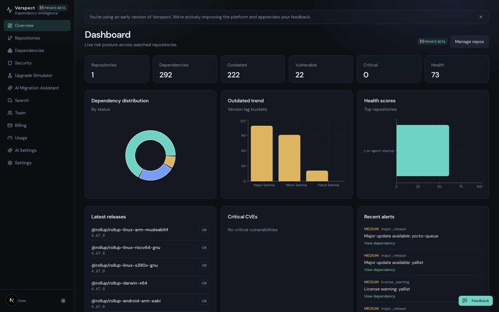</a></p>

**Repository dependency overview**

<p><a href="docs/assets/screenshots/app/repository-inventory.png">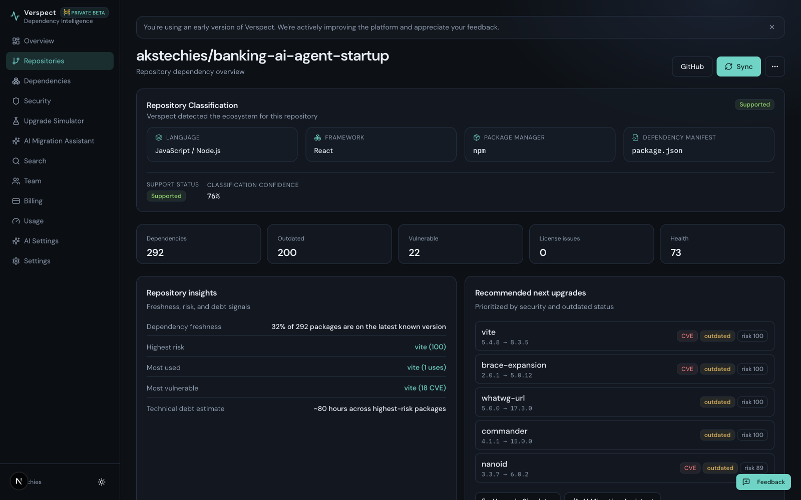</a></p>

<details>
  <summary>Explore more authenticated application screenshots</summary>

  **Security findings**

  <p><a href="docs/assets/screenshots/app/security-findings.png">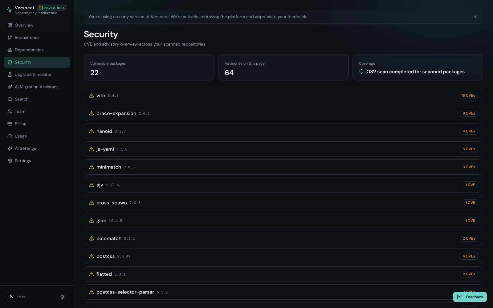</a></p>

  **Dependency graph and inventory**

  <p><a href="docs/assets/screenshots/app/dependency-graph.png">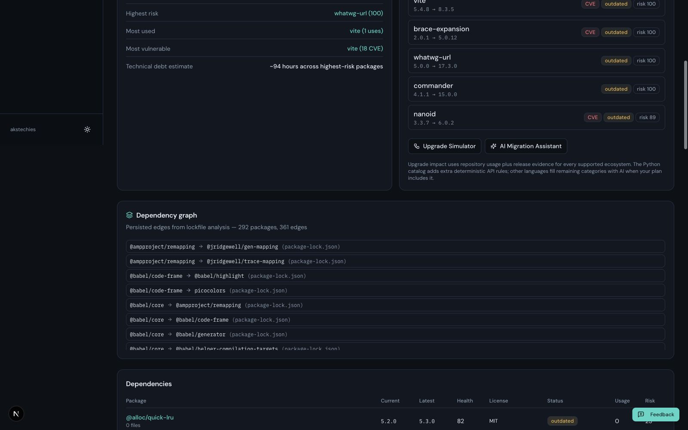</a></p>

  **Package health and upgrade advice**

  <p><a href="docs/assets/screenshots/app/dependency-analysis-detail.png">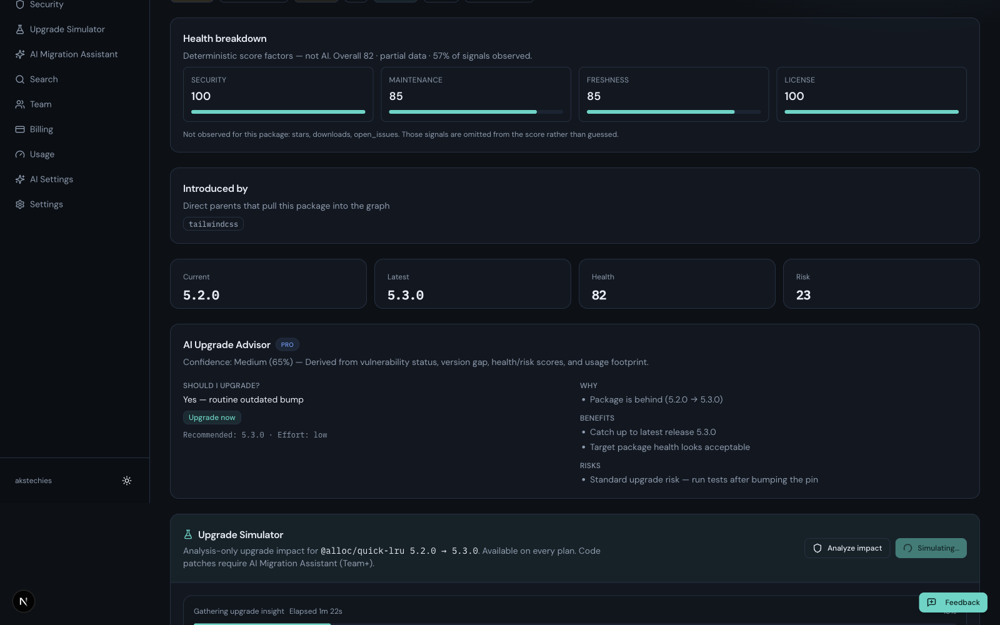</a></p>

  **Upgrade simulation — Pydantic**

  <p><a href="docs/assets/screenshots/app/upgrade-simulation-pydantic-in-progress.png">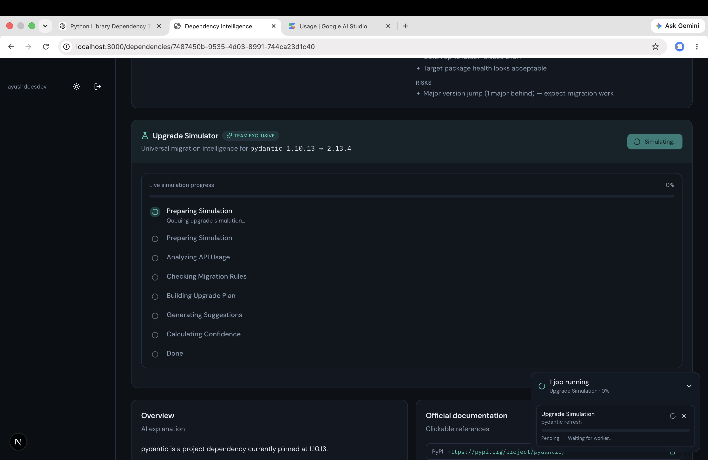</a></p>

  **Upgrade simulation — Babel in progress**

  <p><a href="docs/assets/screenshots/app/upgrade-simulation-babel-in-progress.png">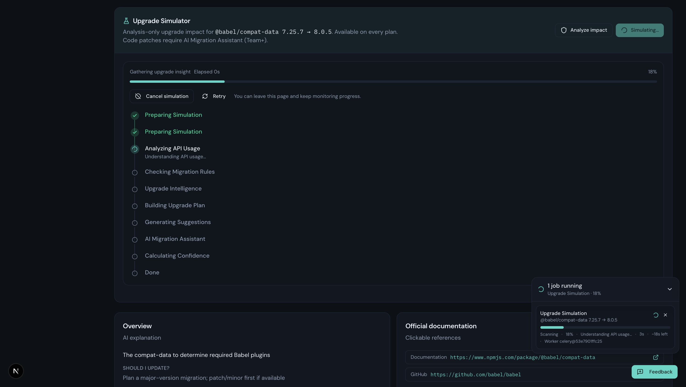</a></p>

  **Upgrade simulation — Babel analysis results**

  <p><a href="docs/assets/screenshots/app/upgrade-simulation-babel-results.png">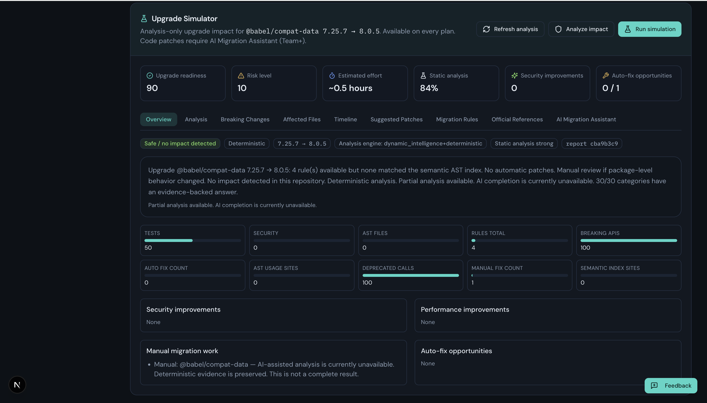</a></p>

  **Migration Assistant package selection**

  <p><a href="docs/assets/screenshots/app/migration-assistant.png">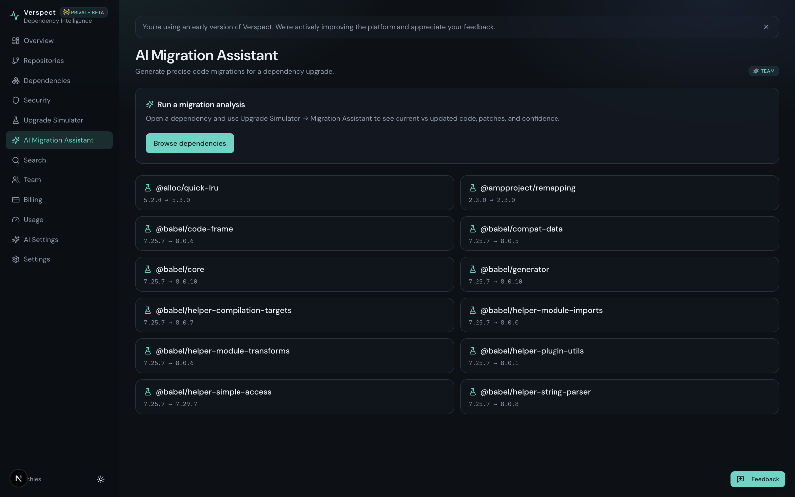</a></p>
</details>

<details>
  <summary>Marketing website and interactive demos</summary>

  **Landing page — hero**

  <p><a href="docs/assets/screenshots/landing-hero.png">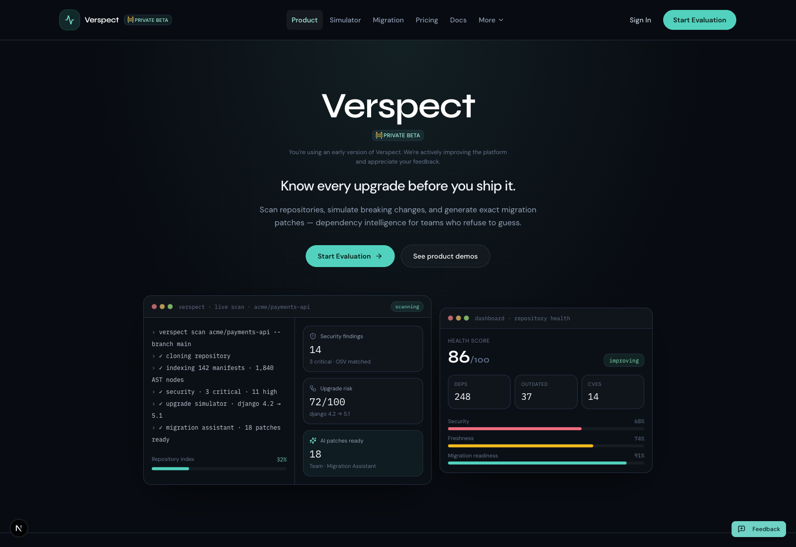</a></p>

  **Landing page — full page** · <a href="docs/assets/screenshots/landing-full-page.png">Open the full-page screenshot</a>

  <p><a href="docs/assets/screenshots/landing-full-page.png">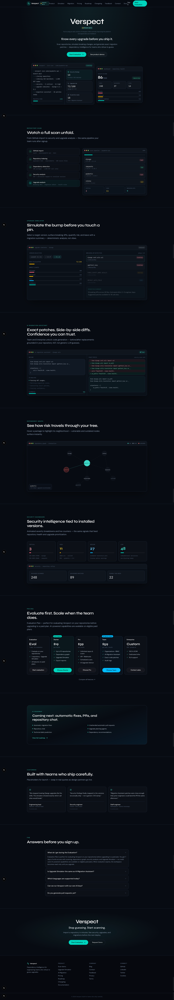</a></p>

  **Repository scan demonstration**

  <p><a href="docs/assets/screenshots/scan-demonstration.png">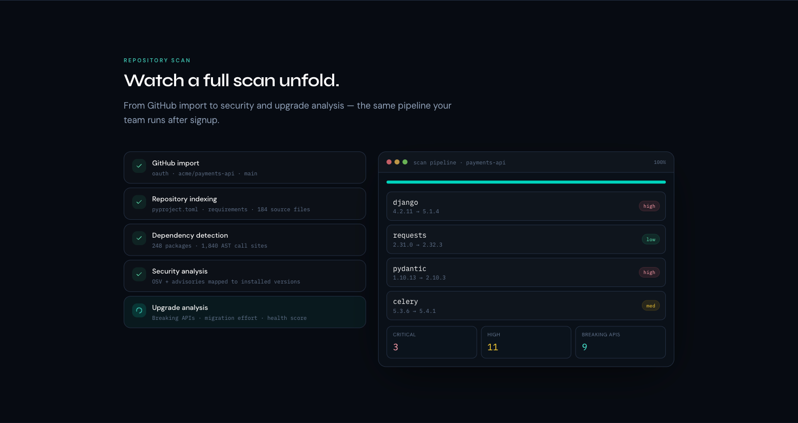</a></p>

  **Upgrade simulator demonstration**

  <p><a href="docs/assets/screenshots/upgrade-simulator-demonstration.png">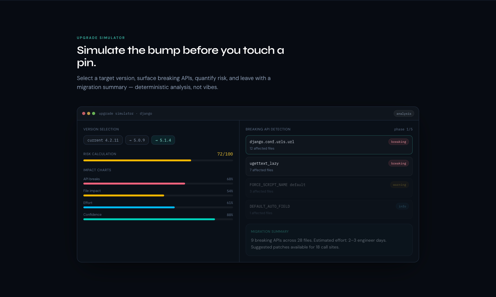</a></p>

  **Migration assistant demonstration**

  <p><a href="docs/assets/screenshots/migration-assistant-demonstration.png">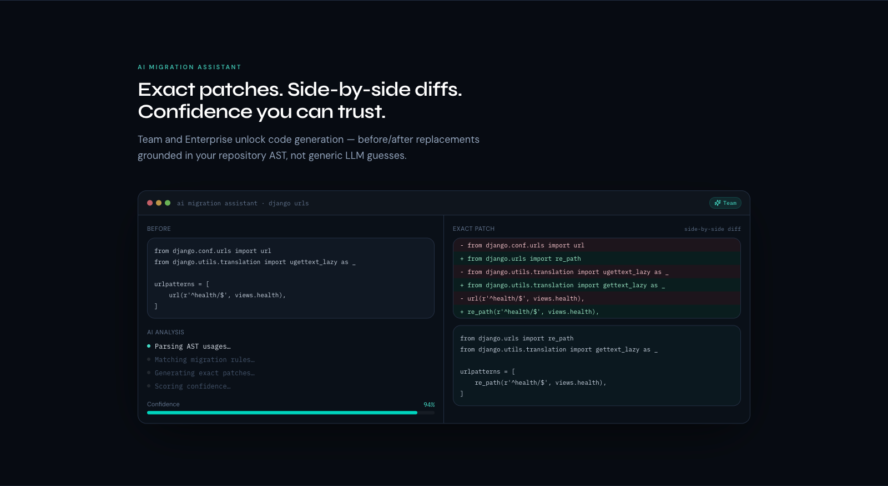</a></p>
</details>

## Features and maturity

| Capability | Status | Notes |
|---|---|---|
| GitHub OAuth and repository import | Implemented | GitHub is the repository integration. Private repository access depends on the OAuth token’s permissions. |
| Dependency inventory and direct/transitive relationships | Implemented with ecosystem limits | Lockfiles provide transitive edges where supported and present. Unsupported repositories finish with an explicit unsupported status. |
| Import/call-site usage evidence | Implemented with ecosystem limits | Python uses AST analysis; other supported ecosystems currently map imports/module paths rather than performing full API call-graph or type-checker analysis. |
| Vulnerability lookup | Implemented | Uses OSV package/version/ecosystem matches. A failed lookup is not proof that a package is vulnerability-free. |
| License and organization policy analysis | Implemented with metadata limits | Uses manifest or registry evidence when available; results can be incomplete when upstream metadata is missing. |
| Dependency health | Implemented | Scores use observed signals such as release timing, registry downloads, and vulnerability data when available; unknown signals are not guessed. |
| Upgrade Simulator | Implemented, evidence-limited | Compares versions against detected usage and available rules. A major version change alone is not labeled breaking. |
| Migration Assistant and patch drafts | Partial | Structured migration rules are deepest for selected Python packages. AI can suggest steps or drafts; generated output requires review and validation. |
| GitHub migration pull request | Implemented with explicit confirmation | A reviewed change can be submitted only after an explicit confirmation. Unattended automatic PR creation is not enabled. |
| AI provider integration | Optional / experimental by provider | Ollama is the default provider setting. Cloud providers require their own credentials; AI is not required for deterministic scanning. |
| Marketing site demonstrations | Implemented as demonstrations | The scan, simulator, and migration sections are interactive examples, not a live account or hosted demo. |

## Supported ecosystems

The current implementation supports these repository formats. Support does not imply identical analysis depth across languages.

| Ecosystem | Manifests and lockfiles | Usage analysis | Upgrade/migration depth |
|---|---|---|---|
| Python | `requirements*.txt`, `pyproject.toml`, Poetry, uv, Pipenv, `setup.py` / `setup.cfg`; relevant lockfiles when present | AST imports, calls, and attributes with file/line evidence | Deterministic catalog for selected packages including Pydantic, NumPy, FastAPI, Flask, and Django; Python alternatives knowledge base |
| JavaScript / TypeScript | `package.json`; npm, Yarn, pnpm lockfiles | Import, require, export, and module specifiers | No general deterministic breaking-change catalog |
| Go | `go.mod`, `go.sum` | Import paths | Registry metadata when available; no general API-level upgrade analysis |
| Java | Maven `pom.xml`; literal Gradle `group:name:version` coordinates | `import` statements | Version catalogs and evaluated Gradle scripts are not processed |
| Rust | `Cargo.toml`, `Cargo.lock` | `use` and `extern crate` | No general API-level upgrade analysis |
| PHP | `composer.json`, `composer.lock` | `use`, `require`, and `include` | No general API-level upgrade analysis |
| Ruby | `Gemfile`, `Gemfile.lock` | `require` and `require_relative` | No general API-level upgrade analysis |

More detail and known parsing limits: [Languages and analysis limits](docs/languages.md).

## Marketing site and demonstrations

The marketing homepage is part of the frontend application. It includes product overviews and interactive scan, simulator, and migration demonstrations: [scan demo](frontend/src/components/marketing/landing/scan-demo.tsx), [upgrade simulator demo](frontend/src/components/marketing/landing/simulator-demo.tsx), and [migration demo](frontend/src/components/marketing/landing/migration-demo.tsx). The homepage assembles them in [`frontend/src/app/(marketing)/page-client.tsx`](frontend/src/app/%28marketing%29/page-client.tsx).

The demonstrations illustrate intended workflows with example data. For real repository results, run the application, authenticate with GitHub, import a repository, and wait for its scan and enrichment jobs to complete.

## Architecture

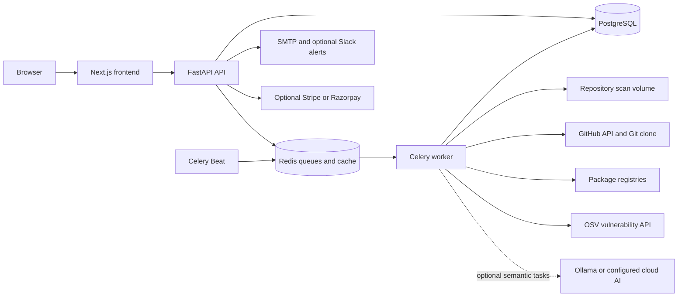

### Scan and upgrade data flow

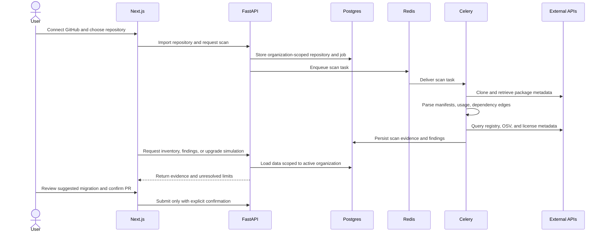

The API scopes repository and analysis records to the active organization. GitHub migration PRs use the acting user’s token. Optional AI is used for semantic suggestions, not to invent deterministic versions, CVE identifiers, or migration catalog facts. See [Architecture](docs/architecture.md) and [Security and data handling](docs/security.md).

## Technology stack

| Area | Technology |
|---|---|
| Backend | Python 3.13, FastAPI, SQLAlchemy, Alembic, Pydantic |
| Frontend | Next.js 15, React 19, TypeScript, Tailwind CSS 4, TanStack Query |
| Data | PostgreSQL 16, Redis 7 |
| Background jobs | Celery worker and Celery Beat |
| Containers | Dockerfiles and Docker Compose |
| Backend tests | pytest and pytest plugins |
| Frontend tests | Vitest, Testing Library; TypeScript type check |
| CI | GitHub Actions workflow at [`.github/workflows/ci.yml`](.github/workflows/ci.yml) |

## Prerequisites

For the complete local stack, install:

- Docker Engine or Docker Desktop with Docker Compose v2.
- Git, to clone repositories for analysis.
- A GitHub OAuth App for interactive GitHub login and repository import.

Node.js 22 and Python 3.13 are used by the frontend/backend containers. They are only needed on the host if you choose to run those services outside Compose.

## Quick start with Docker Compose

From the repository root:

```bash
cp .env.example .env
```

Set the GitHub OAuth values in `.env` if you want to sign in and import repositories. Keep `.env` local; it is ignored by Git. Then start the development services:

```bash
docker compose up --build -d
```

The development Compose configuration starts PostgreSQL, Redis, FastAPI, the Celery worker, Celery Beat, the Next.js development server, and Mailhog. The backend command applies Alembic migrations before starting the API. To apply migrations manually or after a schema update:

```bash
docker compose exec backend alembic upgrade head
```

| Service | Local address |
|---|---|
| Marketing site and application | <http://localhost:3000> |
| FastAPI | <http://localhost:8000> |
| FastAPI interactive docs (development) | <http://localhost:8000/docs> |
| Mailhog inbox | <http://localhost:8025> |

To stop the development services:

```bash
docker compose down
```

This preserves named database and Redis volumes. To remove local data, use Docker’s volume removal options only after confirming the volumes contain no data you need.

## GitHub OAuth setup

Create a GitHub OAuth App for local development with:

- **Homepage URL:** `http://localhost:3000`
- **Authorization callback URL:** `http://localhost:8000/api/v1/auth/github/callback`

Set these variable names in `.env`:

```dotenv
GITHUB_CLIENT_ID=your_github_oauth_client_id
GITHUB_CLIENT_SECRET=your_github_oauth_client_secret
GITHUB_REDIRECT_URI=http://localhost:8000/api/v1/auth/github/callback
GITHUB_WEBHOOK_SECRET=replace_with_a_random_local_value
```

Use placeholders above as examples; replace them locally and do not commit credentials. Private repository scanning requires an OAuth token with appropriate repository access. Production callback configuration must use the public API URL. Optional Google OAuth uses `GOOGLE_CLIENT_ID`, `GOOGLE_CLIENT_SECRET`, and `GOOGLE_REDIRECT_URI`.

## Environment configuration

The complete variable reference is in [`docs/environment.md`](docs/environment.md). For local Compose, start from `.env.example`. The most relevant settings are:

| Purpose | Variable names |
|---|---|
| App origins and security | `APP_ENV`, `APP_URL`, `API_URL`, `SECRET_KEY`, `ALLOWED_HOSTS` |
| GitHub sign-in and webhooks | `GITHUB_CLIENT_ID`, `GITHUB_CLIENT_SECRET`, `GITHUB_REDIRECT_URI`, `GITHUB_WEBHOOK_SECRET` |
| Database and job queue | `POSTGRES_USER`, `POSTGRES_PASSWORD`, `POSTGRES_DB`, `DATABASE_URL`, `DATABASE_URL_SYNC`, `REDIS_PASSWORD`, `REDIS_URL`, `CELERY_BROKER_URL`, `CELERY_RESULT_BACKEND` |
| Frontend public addresses | `NEXT_PUBLIC_APP_URL`, `NEXT_PUBLIC_API_URL` |
| Email and alerts | `SMTP_HOST`, `SMTP_PORT`, `SMTP_USER`, `SMTP_PASSWORD`, `SMTP_TLS`, `SMTP_FROM`, optional `SLACK_WEBHOOK_URL` |

Production startup validates required settings. Use unique secrets, public HTTPS origins, Redis authentication, a real SMTP service, and production OAuth callback URLs. `NEXT_PUBLIC_APP_URL` and `NEXT_PUBLIC_API_URL` are baked into the production frontend image at build time.

## AI providers and optional integrations

AI is optional; deterministic scanning and enrichment do not require it. Provider selection uses `AI_PROVIDER` and supports `ollama`, `openai`, `gemini`, `groq`, and `openrouter`. Configure only the provider variables you use: `OLLAMA_BASE_URL` / `OLLAMA_MODEL`, `OPENAI_API_KEY`, `GEMINI_API_KEY`, `GROQ_API_KEY`, or `OPENROUTER_API_KEY` / `OPENROUTER_BASE_URL`. Cloud fallback is disabled by default for the Ollama path unless explicitly enabled with `AI_ENABLE_CLOUD_FALLBACK`.

When a cloud AI provider is enabled, prompts may include repository-derived context. Review that provider’s data handling terms and configure Verspect accordingly. AI is used for semantic interpretation and suggestions; results should be reviewed before use.

Other optional integrations include Google OAuth, Stripe or Razorpay billing, GitHub inbound webhooks, SMTP notifications, and Slack alerts. Paid checkout requires valid provider configuration; missing billing credentials do not prevent local evaluation.

## Development without Compose

The Compose workflow is the supported full-stack local path. For frontend-only work, install the locked JavaScript dependencies and start Next.js:

```bash
cd frontend
npm ci
npm run dev
```

For backend work, use Python 3.13 and a virtual environment, then install the pinned direct requirements:

```bash
cd backend
python3.13 -m venv .venv
source .venv/bin/activate
python -m pip install -r requirements.txt
cd ..
PYTHONPATH=backend uvicorn app.main:app --reload --host 0.0.0.0 --port 8000
```

The API requires PostgreSQL and Redis settings and services. When running it on the host, configure the database and Redis URLs to point to services reachable from the host; Compose service names such as `postgres` and `redis` resolve only inside the Compose network. Running a host-only frontend or backend does not start the other services automatically.

## Tests and checks

Run frontend checks from the frontend container:

```bash
docker compose exec frontend npm test
docker compose exec frontend npm run lint
docker compose exec frontend npx tsc --noEmit
```

Run backend tests:

```bash
docker compose exec backend pytest -v
```

The GitHub Actions workflow installs backend requirements and runs selected backend scanner/service suites, then installs frontend packages, runs Vitest, and type-checks. It does not currently run a browser end-to-end suite. See [Testing](docs/testing.md).

Do not run `npm run build` in the live Compose frontend while `next dev` is running. The production frontend uses a separate build directory and standalone runtime.

## Production self-hosting

The production Compose file starts PostgreSQL, Redis, a one-shot migration service, FastAPI, Celery worker/Beat, and the standalone Next.js frontend. It does not include a TLS reverse proxy. Put the public HTTPS proxy/load balancer in front of the frontend and API, and route each public origin to the corresponding service.

1. Review [Production deployment](docs/production-deployment.md) and the security notes below.
2. Copy `.env.example` to `.env` on the host and set production values. Never reuse development placeholders.
3. Configure the GitHub OAuth callback as `{API_URL}/api/v1/auth/github/callback`; set `APP_URL`, `API_URL`, `NEXT_PUBLIC_APP_URL`, and `NEXT_PUBLIC_API_URL` to the public HTTPS origins.
4. Build and start the production stack:

   ```bash
   docker compose -f docker-compose.prod.yml up -d --build
   ```

5. Check service health and logs without printing environment values. The Compose migration service runs `alembic upgrade head` before the backend starts.

PostgreSQL and Redis use named persistent volumes. The `scan_repos` volume stores repository clones used by workers; plan access control, backup, and cleanup for it as repository data. The Compose file publishes the frontend and API ports; database and Redis are internal to the Compose network. Configure host firewall and reverse-proxy access accordingly.

Production requires `APP_ENV`, `APP_DEBUG`, `APP_URL`, `API_URL`, `SECRET_KEY`, `ALLOWED_HOSTS`, `POSTGRES_PASSWORD`, `REDIS_PASSWORD`, GitHub OAuth settings, `GITHUB_WEBHOOK_SECRET`, `SMTP_HOST`, `NEXT_PUBLIC_APP_URL`, and `NEXT_PUBLIC_API_URL`. See the deployment guide for complete validation rules and optional integrations. Never paste secret values into tickets, logs, or documentation.

## Security and privacy

- Repository imports and analysis records are organization-scoped. Review [Security and data handling](docs/security.md) for authorization and token handling details.
- GitHub access tokens are stored encrypted by the backend. PR creation requires explicit user confirmation.
- Cloned repository contents reside in the configured scan volume. Treat that volume as sensitive and protect, back up, and clean it according to your retention requirements.
- OSV and package registries receive package identifiers and versions for lookups. Optional cloud AI providers may receive repository-derived context; keep AI disabled or use a local provider if that data flow is not acceptable.
- A missing or failed metadata lookup does not guarantee a clean dependency.
- Keep `.env` and production secrets outside version control. Report vulnerabilities privately using the process in [SECURITY.md](SECURITY.md); do not include credentials or private repository contents in public reports.

## Current limitations and roadmap

- Deterministic breaking-change and migration knowledge is deepest for selected Python packages; a major version bump alone is not treated as a breaking change.
- Non-Python usage analysis does not provide full API call graphs or type-checker-level semantic analysis.
- Gradle version catalogs and evaluated build scripts are not processed. Package metadata can be incomplete or unavailable.
- GitLab, Bitbucket, and a VS Code extension appear in the frontend roadmap data but are not implemented integrations. The roadmap file also marks CLI and beta hardening as in progress; treat this as code-level roadmap state, not a release commitment.
- SSO/SCIM and unattended GitHub PRs are not self-service features in this codebase.
- The application has no public hosted demo or browser E2E suite in this repository.

## Documentation

- [Architecture](docs/architecture.md)
- [Product behavior and limits](docs/product.md)
- [Languages and analysis limits](docs/languages.md)
- [Environment variables](docs/environment.md)
- [Testing](docs/testing.md)
- [Security and data handling](docs/security.md)
- [Operations](docs/operations.md)
- [Production deployment](docs/production-deployment.md)

## Contributing and support

Contributions are welcome. Read [CONTRIBUTING.md](CONTRIBUTING.md) for setup, checks, and pull-request expectations. Before opening a large change, describe the problem and proposed approach in an issue. Keep pull requests focused, include or update relevant tests, run the checks above, and document any behavior or setup changes. Do not include real credentials, private repository data, or user feedback screenshots without permission.

For bugs, include reproduction steps, expected and actual behavior, relevant versions, and redacted logs. For security issues, follow the private reporting process in [SECURITY.md](SECURITY.md).

## License and project branding

Original Verspect code, the marketing website, documentation, and original project assets are licensed under [GNU Affero General Public License v3.0 or later](LICENSE) (`AGPL-3.0-or-later`). Third-party software and external resources keep their respective licenses; review [THIRD_PARTY_NOTICES.md](THIRD_PARTY_NOTICES.md).

The Verspect name, logo, and official branding are reserved project branding. The software license does not grant trademark or branding rights.
