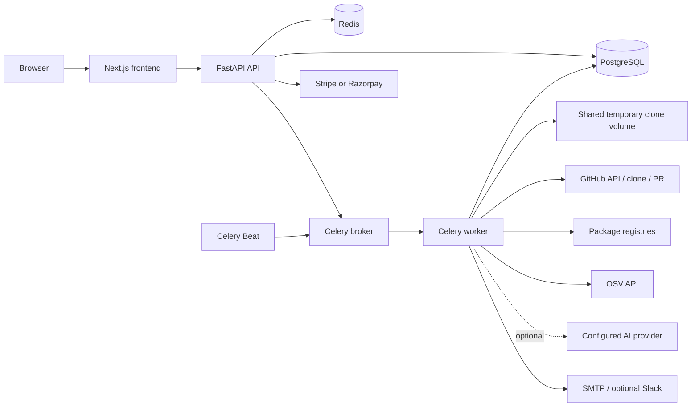

# Verspect Project Brief

This document is a source-grounded summary of the repository as inspected on 2026-10-30. It describes implementation found in this checkout; product claims in marketing copy are not treated as proof that a feature works end to end.

## Status vocabulary

- **Verified:** implementation or configuration is present in source.
- **Partial:** some implementation exists, with material gaps or uneven maturity.
- **Planned:** explicitly marked as future work or not implemented in the support registry.
- **Unknown:** cannot be established from this repository alone.

## Product purpose

**Verified:** Verspect connects to GitHub repositories to inventory dependencies, analyze usage, surface version and vulnerability information, evaluate license policy and health signals, and help teams assess upgrades and migrations. The product presents deterministic repository evidence separately from optional AI interpretation. See [README](README.md#L3), [product overview](docs/product.md#L3), and [supported language depth](backend/app/scanners/language_support.py#L35).

**Intended users:** engineering teams that need visibility into dependency risk and upgrade impact. The repository contains organization, membership, role, billing, and team-oriented surfaces; the exact target-customer profile is not specified beyond this.

## Verified technology stack

| Layer | Implementation |
|---|---|
| Backend | Python 3.13, FastAPI, Starlette, SQLAlchemy 2, Pydantic 2, Alembic; pinned Python requirements in [backend/requirements.txt](backend/requirements.txt) |
| Frontend | Next.js 15, React 19, TypeScript, Tailwind CSS 4, TanStack Query, Vitest; npm lockfile in [frontend/package-lock.json](frontend/package-lock.json) |
| Database | PostgreSQL 16; SQLAlchemy async and sync sessions ([database setup](backend/app/core/database.py#L30)) |
| Queue/cache | Redis 7 and Celery; queues and periodic work in [Celery configuration](backend/app/core/celery_app.py#L10) |
| Runtime | Docker Compose for development and production; Python 3.13 backend/worker images; Node 22 frontend image |
| Authentication | GitHub OAuth; optional Google OAuth; email/password; JWT; bcrypt; encrypted GitHub tokens |
| AI | Adapters for Ollama, OpenAI, Gemini, Groq, and OpenRouter; provider-based and optional ([provider factory](backend/app/ai/providers/factory.py)) |
| Billing | Stripe and Razorpay adapters; production checkout needs provider configuration |
| Tests/CI | pytest, Vitest, TypeScript check, GitHub Actions ([CI workflow](.github/workflows/ci.yml)) |

## Architecture

**Verified deployment components:** Next.js frontend, FastAPI API, PostgreSQL, Redis, one-shot Alembic migration service, Celery worker, and Celery Beat. Production wiring is in [docker-compose.prod.yml](docker-compose.prod.yml#L13). The separate [Nginx config](docker/nginx/nginx.conf#L9) is not included as a service in that Compose file; TLS termination and public ingress are deployment responsibilities not defined there.

**Data flow:** A user authenticates and imports repositories through the API. The API associates repository records with the active organization and dispatches scan jobs. Workers clone or update repositories, classify language and package manager, parse manifests and lockfiles, analyze imports/usages, store dependency relationships, and enrich results from registries, OSV, license rules, and observed health signals. Optional AI tasks provide semantic summaries or migration suggestions. A user can review a migration and explicitly confirm eligible GitHub PR publication. See [operations flow](docs/operations.md#L27), [scan task dispatch](backend/app/api/v1/scans.py#L385), and [PR endpoint](backend/app/api/v1/migration.py#L335).

**API entry points:** `backend/app/main.py` builds FastAPI, configures CORS and production trusted-host checks, mounts `/api/v1` and `/api/ai`, and provides `/health` ([application setup](backend/app/main.py#L47)). The versioned router covers auth, organizations, billing, repositories, dependencies, migration, scans, alerts, dashboard, search, webhooks, AI, feedback, contact, and admin endpoints ([router](backend/app/api/v1/router.py#L26)).

**Data model:** Users and organizations/memberships own repositories. Repositories have scans, dependencies, dependency relationships, usage records, alerts, and upgrade activity. Additional models cover vulnerabilities, releases, migration rules/reports, subscriptions, usage events, invoices, audit logs, feedback, and contact requests. See [models](backend/app/models) and [Alembic revisions](backend/alembic/versions).

## Feature inventory and maturity

| Feature | Status | Evidence and boundaries |
|---|---|---|
| GitHub repository import and scanning | **Verified** | API dispatches Celery work; worker pipeline clones, parses, and persists results ([scan tasks](backend/app/services/tasks/scan_tasks.py)) |
| Dependency manifests, lockfiles, usage, relationships | **Verified; depth varies** | Ecosystem analyzer and pipeline registries under [backend/app/scanners](backend/app/scanners) |
| OSV vulnerability checks | **Verified** | [OSV client](backend/app/scanners/osv.py); query failure is distinct from a confirmed clean result in its contract |
| Registry/version and license enrichment | **Verified** | Registry clients and [license policy](backend/app/scanners/license.py) |
| Health scoring | **Verified** | Uses observed signals; missing data limits confidence ([health scorer](backend/app/scanners/health.py)) |
| Upgrade intelligence/simulator | **Verified, uneven evidence coverage** | Deterministic and AI-assisted paths under [upgrade intelligence](backend/app/services/upgrade_intelligence); major version changes alone are not classified as breaking ([product docs](docs/product.md#L18)) |
| AI upgrade advisor | **Verified, provider-dependent** | Provider adapters and structured fallbacks; requires configured provider for live AI output |
| Migration plans and patches | **Partial** | Migration engine and validation exist; rule/catalog depth differs by ecosystem ([migration engine](backend/app/migration_engine)) |
| GitHub PR publishing | **Verified, gated** | Explicit confirmation, entitlement, repository permission, and validated patch checks are required ([migration API](backend/app/api/v1/migration.py#L335)) |
| Organizations, roles, entitlements | **Verified** | Active-organization scoping and write-role checks in [repository access](backend/app/services/repo_access.py#L19) |
| Billing | **Verified, configuration-dependent** | Stripe/Razorpay providers; production payment flow remains unavailable until credentials and plan IDs are configured ([billing docs](docs/environment.md#L66)) |
| Email verification | **Partial / incomplete journey** | Backend creates a verification token and exposes an endpoint, but registration does not send it and no verification page is present ([auth routes](backend/app/api/v1/auth.py#L225)) |
| Password reset | **Partial / incomplete journey** | Backend issues and emails a reset link; repository frontend has a forgot-password page but no reset-password route ([forgot-password page](frontend/src/app/forgot-password/page.tsx)) |
| C# and Kotlin | **Planned** | Explicitly listed as coming soon ([language support registry](backend/app/scanners/language_support.py#L46)) |

### Ecosystem maturity

The canonical support registry marks Python as **Fully Supported**, JavaScript/TypeScript, Go, Java, Rust, PHP, and Ruby as **Supported**, and C#/Kotlin as **Coming Soon** ([language support registry](backend/app/scanners/language_support.py#L35)). “Supported” does not imply equal upgrade-rule or migration coverage. The README currently says several non-Python upgrade paths remain unresolved unless rules exist ([README matrix](README.md#L9)); the source also describes dynamic upgrade intelligence across supported ecosystems ([language support registry](backend/app/scanners/language_support.py#L38)). Treat exact per-package and per-version migration coverage as **partial**, and reconcile the README with implementation before relying on it as a capability matrix.

## Integrations

- **GitHub:** OAuth, repository listing/import, cloning, inbound webhooks, and opt-in PR creation.
- **Google:** optional OAuth.
- **OSV:** vulnerability queries.
- **Package registries:** PyPI, npm, Go, Maven Central, crates.io, Packagist, and RubyGems ([operations](docs/operations.md#L27)).
- **AI:** Ollama, OpenAI, Gemini, Groq, OpenRouter; availability depends on configuration.
- **Billing:** Stripe or Razorpay; payment actions require live configuration.
- **Notifications:** SMTP and optional Slack webhook.

## Deployment requirements

**Verified minimum topology:** public frontend and API, PostgreSQL with persistent data, Redis with authentication, an always-running Celery worker and Beat process, and shared clone storage accessible to backend/worker. Production Compose also runs an Alembic migration job before backend startup ([production Compose](docker-compose.prod.yml#L60)). GitHub OAuth and SMTP are required by production settings; AI and billing providers are optional until their features are used ([environment variable guide](docs/environment.md#L7)).

Production images use Python 3.13 and Node 22. `NEXT_PUBLIC_APP_URL` and `NEXT_PUBLIC_API_URL` are baked into the frontend image during build ([frontend Dockerfile](frontend/Dockerfile#L14)). External TLS/ingress, backups, monitoring, and recovery procedures are operational requirements but are not deployed as managed services by the Compose configuration. A reliable production setup cannot be assumed to fit free tiers because it needs persistent storage and continuously available background processes; actual cost is **unknown** and depends on workload and hosting limits.

## Security findings and blockers

### Verified controls

- Production configuration rejects placeholder secrets, local public URLs, debug mode, missing GitHub OAuth, development SMTP, and Redis URLs without passwords ([settings validation](backend/app/core/config.py#L189)).
- GitHub credentials are Fernet-encrypted using material derived from `SECRET_KEY` ([security helpers](backend/app/core/security.py#L19)).
- GitHub webhook signatures use HMAC-SHA256 and constant-time comparison ([webhook verification](backend/app/api/v1/webhooks.py#L46)).
- Repository access resolves the active organization and applies role checks; cross-organization IDs return 404 ([repository access](backend/app/services/repo_access.py#L19)).
- Production config disables FastAPI docs and enables trusted-host middleware ([main app](backend/app/main.py#L43)).

### Risks and release blockers

1. **Bootstrap credential risk:** a hardcoded development admin password exists in [config](backend/app/core/config.py#L65) and [bootstrap service](backend/app/services/bootstrap_admin.py#L18). Bootstrap runs for `development` and `beta`, not `production` ([bootstrap guard](backend/app/services/bootstrap_admin.py#L29)). Do not deploy a reachable beta instance with defaults. The credential itself is intentionally not reproduced here.
2. **Redis fallback:** OAuth tickets and refresh-token revocation fall back to process-local memory when Redis cannot be reached ([OAuth store selection](backend/app/services/oauth_flow.py#L149)). With multiple API workers, requests routed to different processes may not share ticket/revocation state.
3. **Email account flows:** verification token issuance is not accompanied by an email; reset email links to a frontend route that is absent from this repository. Verification/reset tokens are stored raw in user fields ([user model](backend/app/models/user.py#L36)).
4. **Process-local throttling:** auth, feedback, and contact rate limits are in-memory and do not aggregate across API processes ([rate limiter](backend/app/core/rate_limit.py#L11)).
5. **Secret inventory unknown:** `.env` is ignored by Git and was not inspected. No tracked `.env` was found in the audit. Git history was not audited for previously committed secrets.
6. **Operational isolation:** repository source is cloned to a shared volume. Production Compose does not show a separate sandbox for parsing untrusted source code.

## Open-source release readiness

- **README and setup:** present; quick start and docs are linked from [README](README.md).
- **License:** release blocker if this is to be open source. README states “Proprietary — All rights reserved” ([README license section](README.md#L87)); no root `LICENSE` file was found in the audit.
- **Governance:** no `CONTRIBUTING.md`, `CODE_OF_CONDUCT.md`, issue templates, or PR template found. `docs/security.md` exists, but a root `SECURITY.md` with a reporting process was not found.
- **CI:** GitHub Actions covers backend scanner/service tests and frontend unit tests/typechecking, but omits backend API/migration suites, frontend lint, and production build ([CI workflow](.github/workflows/ci.yml#L8)).
- **Reproducibility:** npm lockfile exists, but CI uses `npm install`; Python requirements are pinned without a full resolver lockfile. No browser end-to-end suite or dependency audit is configured.
- **Release/demo:** no release workflow or tag/version policy was found. Marketing components provide interactive demos; a hosted demo URL or screenshot gallery was not verified.
- **Third-party attribution:** dependency manifests exist; a separate attribution inventory was not found.

## Known limitations and technical debt

- Ecosystem support depth is uneven; Python has the strongest explicitly documented deterministic migration catalog.
- AI output depends on external provider availability/configuration and should remain advisory to deterministic evidence.
- Account verification and reset journeys appear incomplete in the frontend/backend combination.
- Redis fallback and in-memory rate limiting do not provide consistent cross-process behavior.
- CI coverage does not match the breadth of the existing test suites and omits production build/lint checks.
- README feature claims and the language support registry differ on non-Python upgrade coverage.
- No automated backups, restore drills, dependency vulnerability audit, or deployment workflow are present in the repository.
- Current dependency health and live deployment configuration are **unknown**; no live package advisory check or deployment inspection was performed.

## Working-tree context

At the start of the architecture audit, `git status --short` showed these pre-existing modifications:

- `backend/celerybeat-schedule` — modified binary runtime schedule file; its binary content was not interpreted.
- `frontend/next-env.d.ts` — modified generated TypeScript environment file; its change was not part of this brief.

Neither file was edited, restored, discarded, reset, stashed, or overwritten while preparing this brief.

**Status-check limitation for this brief creation:** the current workspace did not contain a `.git` directory when this file was created, so `git status --short` could not run before or after creation. The earlier audit’s status snapshot above is preserved as historical context, not presented as a fresh status. No conclusion about the post-creation Git status is possible from this checkout.

## Unknowns

- Whether a live deployment exists and what ingress, TLS, backups, monitoring, and operational controls it uses.
- Whether live OAuth, SMTP, billing, registry, and AI integrations are configured and exercised.
- Intended open-source license and policy for accepting contributions.
- Exact customer use cases, service objectives, data-retention commitments, and support expectations.
- Whether any secret was committed in prior Git history.
- Exact per-ecosystem upgrade/migration coverage on representative repositories.

## Source-of-truth references

- [Product overview](docs/product.md)
- [Architecture](docs/architecture.md)
- [Operations](docs/operations.md)
- [Language support and analysis limits](docs/languages.md)
- [Environment variables](docs/environment.md)
- [Production deployment](docs/production-deployment.md)
- [Security and data handling](docs/security.md)
- [Testing](docs/testing.md)
